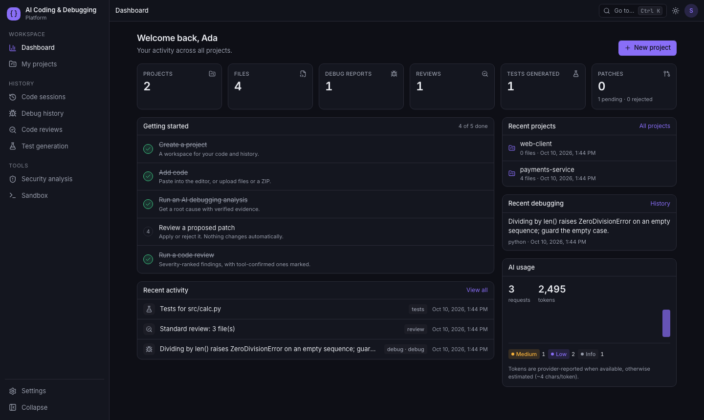
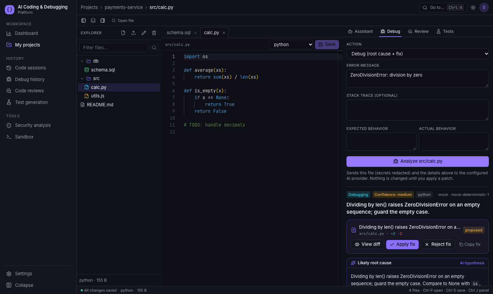
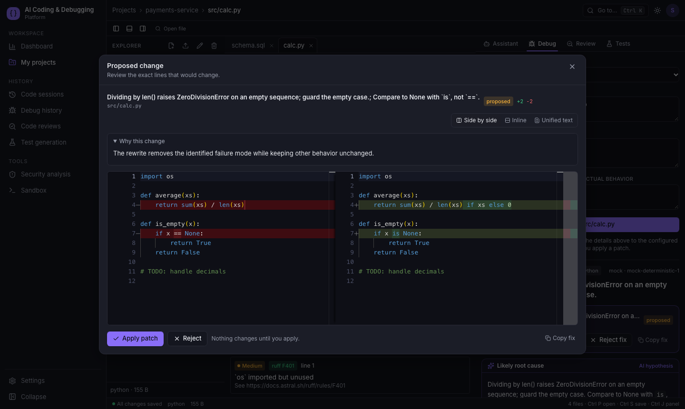
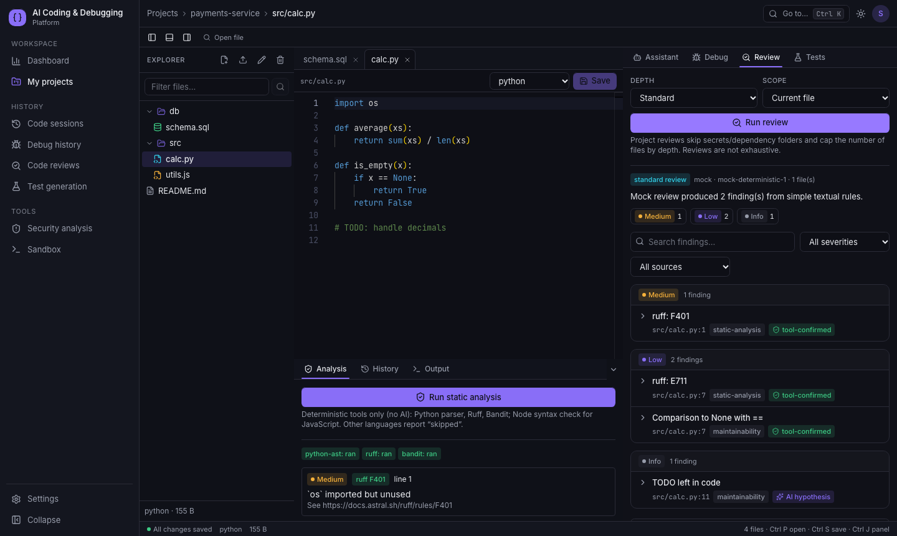
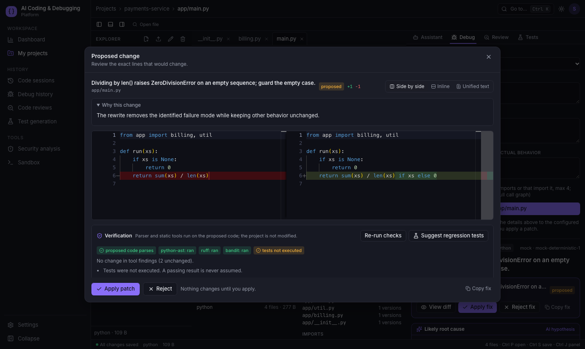
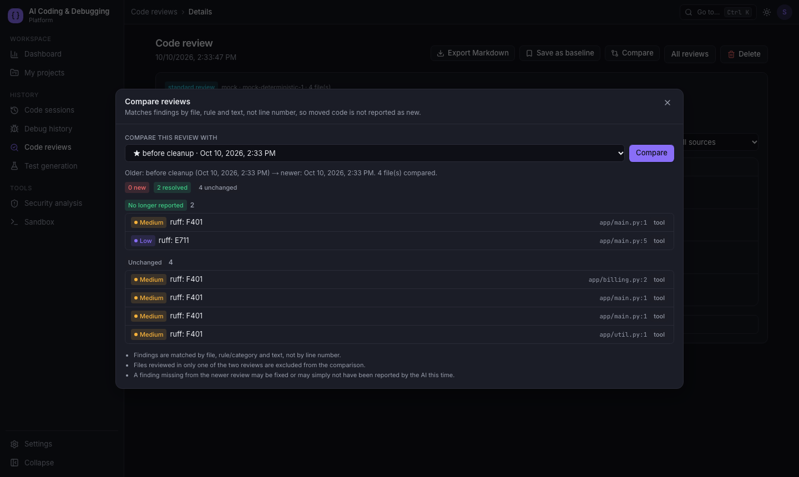
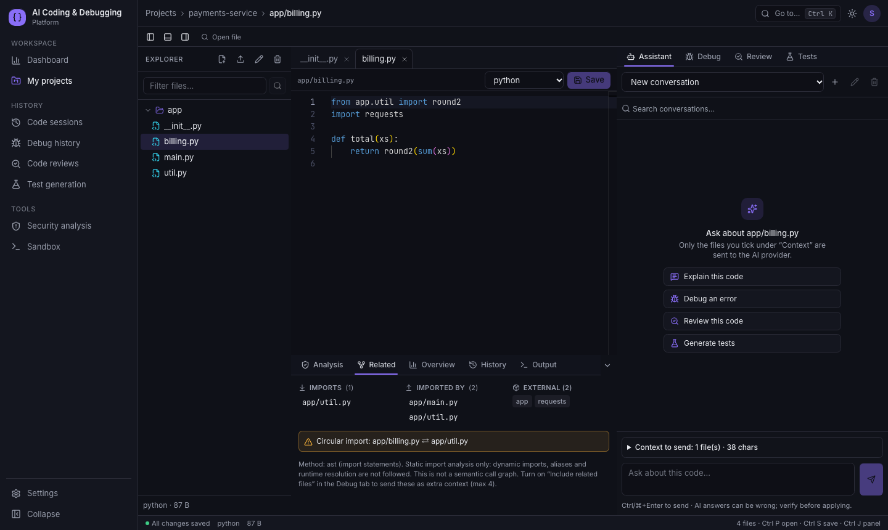

# AI Coding & Debugging Platform

A full-stack developer workspace: paste or upload code, get **evidence-based debugging reports**, **severity-labelled code reviews**, **generated tests** and **diff-reviewed patches**, with a project file explorer, Monaco editor, streaming chat, version history and an optional **Docker-isolated execution sandbox**.

Design principle: *deterministic tool findings and AI hypotheses are always labelled differently.* Line numbers are only shown when the server finds the quoted code in the file; coverage is never invented; nothing is applied without an explicit click.

| Layer | Tech |
|---|---|
| Frontend | Next.js 16, React 19, TypeScript, Tailwind, Monaco (+ diff editor), react-markdown (sanitized), Lucide |
| Backend | Python 3.11+, FastAPI, Pydantic v2, SQLAlchemy 2 (async), Alembic, PostgreSQL |
| AI | Provider interface: **Groq**, **Ollama**, deterministic **mock** (no OpenAI dependency) |
| Analysis | `ast`, Ruff, Bandit, `node --check` (fixed-arg subprocesses) |
| Sandbox | Separate provider abstraction; local Docker implementation, disabled by default |

## Screenshots
| | |
|---|---|
|  |  |
|  |  |

Dark is the default theme; a light theme is one click away (`docs/screenshots/workspace-light.png`). Screenshots use the mock AI provider and a local test account.

### Code intelligence & verification
| | |
|---|---|
|  |  |
|  | |

## Features
Auth & per-user isolation · projects (create/rename/archive/delete/search/paginate) · file tree, upload files or ZIP · Monaco editor with resizable panels, dark/light themes · debugging tasks (debug, explain error, root cause, fix, alternatives, line-by-line, edge cases, readability, optimize, refactor, repro) · reports saved + Markdown export · code review (quick/standard/deep, file or project manifest) · pytest / Vitest / Jest test generation with diff preview and save-to-project · patch create/apply/reject with conflict detection · file version history & restore · streaming chat with explicit context selection, preview, secret warnings, rename/search/delete · static analysis & secret scan page · dashboard with real usage stats · provider/model settings · sandbox status & execution results · retention cleanup job.

## Run locally (macOS / Linux / Windows)
Requirements: Python 3.11+, Node 20+, PostgreSQL 14+ (or Docker). Quickest path uses SQLite-free Postgres via Docker:

```bash
docker compose up -d db            # PostgreSQL on :5432 (set DB_PORT=5433 if taken)
cp .env.example backend/.env       # then edit; defaults use the mock provider
```
**Backend**
```bash
cd backend
python -m venv .venv
source .venv/bin/activate          # Windows: .venv\Scripts\activate
pip install -r requirements-dev.txt
alembic upgrade head               # create/upgrade the schema
uvicorn app.main:app --reload --port 8000
```
**Frontend**
```bash
cd frontend
echo "NEXT_PUBLIC_API_URL=http://localhost:8000" > .env.local
npm install
npm run dev                        # http://localhost:3000
```
Without Postgres you can set `DATABASE_URL=sqlite+aiosqlite:///./dev.db` for a quick try.

**Health checks**: `curl localhost:8000/api/v1/health` · `curl localhost:8000/api/v1/ready` · OpenAPI docs at `http://localhost:8000/docs`.

### AI providers
- **mock** (default): deterministic, offline; recognises a few patterns (e.g. `sum(x)/len(x)`, `== None`) so every workflow is demoable.
- **Ollama**: `ollama pull llama3.1`, then `AI_PROVIDER=ollama OLLAMA_MODEL=llama3.1`. Code stays on your machine.
- **Groq**: create a key at console.groq.com, set `AI_PROVIDER=groq GROQ_API_KEY=...`. In the app, Settings → acknowledge the data-flow notice (selected code is sent to Groq, secrets redacted first). Free-tier limits change; model availability and limits change (the earlier default `llama-3.3-70b-versatile` was retired) — list models with `curl https://api.groq.com/openai/v1/models -H "Authorization: Bearer $GROQ_API_KEY"` and set `GROQ_MODEL` accordingly; check your Groq console for quotas. 429s are surfaced to the UI.

Users can pick provider/model in Settings; the server default comes from env.

### Sandbox (optional, local only)
See [`sandbox/README.md`](sandbox/README.md). Short version: `docker build -t aicp-sandbox:latest sandbox` and `EXECUTION_ENABLED=true`.

## Tests (results from the last run on macOS, Python 3.11, Node 22)
```bash
cd backend  && pytest -q                 # 65 passed (incl. 10 real-Docker sandbox tests; they skip if Docker is absent)
cd frontend && npm run typecheck && npm run lint && npm test   # tsc clean, eslint clean, 23 vitest tests passed
cd frontend && npx playwright install chromium && npm run test:e2e   # 3 passed against live backend + Postgres + Monaco
```
Backend tests also pass against PostgreSQL: `TEST_DATABASE_URL=postgresql://... pytest -q`. Migrations were verified on Postgres 14 and 16 and SQLite (upgrade → downgrade → upgrade).
E2E expects the backend on :8000 with `AI_PROVIDER=mock`, `EXECUTION_ENABLED=false`, and the frontend on :3000.

## Deployment (Neon + Render + Vercel, all free tiers)
Free-tier facts (verify on the provider pages, they change): Render free web services sleep after 15 min idle (~1 min cold start); Render's own free Postgres expires after 30 days, so this project uses **Neon** for the database ([Render docs](https://render.com/docs/free)).

**1. Database (Neon)** – create a project, copy the *pooled* connection string (`postgresql://…-pooler…/db?sslmode=require`). The app converts `sslmode`/`channel_binding` for asyncpg and disables prepared-statement caching for pooler hosts automatically.

**2. Backend (Render)** – New → Blueprint → pick this repo (`render.yaml`). When prompted, set:

| Variable | Value |
|---|---|
| `DATABASE_URL` | Neon connection string |
| `CORS_ORIGINS` | your exact Vercel origin, e.g. `https://my-app.vercel.app` |
| `GROQ_API_KEY` | key from console.groq.com |
| `SECRET_KEY` | generated automatically by the blueprint |
| `AI_PROVIDER` / `EXECUTION_ENABLED` / `ENVIRONMENT` | `groq` / `false` / `production` (preset) |

Start command (preset): `alembic upgrade head && uvicorn app.main:app --host 0.0.0.0 --port $PORT --proxy-headers --forwarded-allow-ips "*"`. Migrations run on every start and are idempotent. Production refuses to boot with a weak `SECRET_KEY`, SQLite, wildcard CORS, or execution enabled, and refuses the mock AI provider unless `ALLOW_MOCK_PROVIDER=true`.

**3. Frontend (Vercel)** – import the repo, Root Directory `frontend`, env `NEXT_PUBLIC_API_URL=https://<service>.onrender.com` (public, not secret; baked in at build time). Then set `CORS_ORIGINS` on Render to the final Vercel origin and redeploy if needed.

**4. Verify** – `curl https://<service>.onrender.com/api/v1/ready` → `{"status":"ready","database":true,...}`; register in the UI; in Settings acknowledge the external-AI notice; run a debug request.

Execution stays disabled in production: free hosts cannot provide safe isolation. Add it later via a separate hardened runner implementing `SandboxProvider`.

## Layout
```
frontend/  src/{app,components,features,editor,lib,hooks,types}  tests/  e2e/
backend/   app/{api,core,models,schemas,services,ai,debugging,code_review,static_analysis,patching,sandbox}  migrations/  tests/
sandbox/   Dockerfile README.md
docker-compose.yml  render.yaml  .env.example  SECURITY.md
```

## Code intelligence (what it is and isn't)
- **Import graph** (`GET /projects/{id}/graph`, `/files/{id}/related`): Python via `ast`, JavaScript/TypeScript via pattern matching. Reports internal imports, importers, external packages and circular imports. It is static import analysis, **not** a semantic call graph; dynamic imports and aliases are not followed. Other languages are reported as unsupported.
- **Related-file context**: the Debug tab can include a file's direct imports/importers (max 4) as extra AI context; the report lists exactly which were sent.
- **Question-relevant files** (`POST /projects/{id}/retrieve`): lexical ranking of paths, definitions and terms. It is not embeddings-based. It only *suggests* files; nothing is sent until you send your message.
- **Review quality**: AI findings that restate a tool finding (same lines, same subject) are merged into the deterministic finding ("also reported by AI"); AI-vs-AI repeats are merged too. Reviews can be saved as **baselines** and compared by line-independent fingerprints (`GET /reviews/{a}/compare/{b}`); reports export to Markdown.
- **Patch verification** (`POST /patches/{id}/verify`): before applying, the proposed code is parsed and run through Ruff/Bandit (Python) or `node --check` (JavaScript) and compared with the original (new vs. resolved findings). The project is not modified. Tests run only if the isolated sandbox is available and are otherwise reported as *not executed*; a pass is never assumed. Applying records a post-apply check and an audit trail (verified/applied/rejected/regression-tests events).
- **Regression tests** (`POST /patches/{id}/regression-tests`): AI-suggested tests derived from the diff, saved as generated tests, labelled not executed.
- **Project overview** (`GET /projects/{id}/overview`): language breakdown, most-edited files, latest review severities, import stats. All computed from stored data.

## Account & data management
- Self-service deletion: Settings → Delete account (`DELETE /api/v1/auth/me`, password required) removes the account and everything it owns.
- Operators can list and remove throw-away accounts with `backend/scripts/cleanup_test_accounts.py` (dry-run by default; only `…@example.com` patterns; deletion needs `--delete --expect N` matching the dry-run count; prints no secrets). Run it from `backend/` with `DATABASE_URL` set in your shell:
  ```bash
  python -m scripts.cleanup_test_accounts                      # dry run
  python -m scripts.cleanup_test_accounts --delete --expect 7  # delete exactly those 7
  ```

## Known limitations
- Static analysis is real only for Python (ast, Ruff, Bandit) and JavaScript syntax (`node --check`); TypeScript and other languages get AI analysis only and are labelled "skipped/unavailable".
- Generated tests are never executed automatically; sandboxed pytest runs are manual from the Run tab and only if the sandbox is enabled.
- Review line verification relies on the model quoting code exactly; unmatched quotes show "line not verified".
- Mock provider is rule-based, for testing/demo only. Small local models may produce schema-invalid JSON (one automatic repair retry, then a clear error).
- Monaco loads its assets from a CDN at runtime. Rate limiting is per-process. See `SECURITY.md`.
- Free-tier cold starts and quota changes are outside this project's control.
